<p align="center">
  
</p>

<h1 align="center">Cofrinho</h1>

<p align="center">
  <b>Software financeiro para Android, criado como um REA do app “Money Tracker – Expense Budget”.</b><br>
  Despesas, receitas, orçamentos, contas e divisão de gastos — tudo offline, no seu celular.
</p>

<p align="center">
  Android 7.0+ · Versão 1.0.0 · APK único (universal) · Português e inglês · Sem login, anúncios ou rastreamento
</p>

<p align="center"><i>Esta é a foto do software de finanças: o gato da sorte pirata guardando uma moeda dourada — o “cofrinho” do app.</i></p>

---

## Sumário

- [O que é este projeto: um REA do software](#o-que-é-este-projeto-um-rea-do-software)
- [Telas](#telas)
- [Funcionalidades](#funcionalidades)
- [Instalar no celular](#instalar-no-celular)
- [Como a engenharia reversa foi feita](#como-a-engenharia-reversa-foi-feita)
- [Original × Cofrinho](#original--cofrinho)
- [Desenvolvimento](#desenvolvimento)
- [Arquitetura](#arquitetura)
- [Testes e verificação](#testes-e-verificação)
- [Privacidade](#privacidade)
- [Aviso legal](#aviso-legal)
- [Créditos](#créditos)

## O que é este projeto: um REA do software

**REA** — *Reverse Engineer Anything* — é uma ferramenta de engenharia reversa ([morluto/rea](https://github.com/morluto/rea), [rea.tools](https://rea.tools)) que inspeciona aplicativos sem o código-fonte e mostra as evidências de como cada funcionalidade é feita.

Este repositório é um **REA do software financeiro “Money Tracker – Expense Budget”** (pacote `com.freeman.moneymanager`, versão 1.1.147, feito em Flutter):

1. o app original foi **analisado com o REA** — identificação do build Flutter, leitura do snapshot Dart, esquema do banco de dados, manual de ajuda embutido e traduções;
2. o resultado virou uma **especificação** de telas, dados e regras de negócio ([relatório completo](docs/analise-engenharia-reversa.md));
3. o app foi **recriado do zero**, com código, textos, ícones e ilustrações próprios — nenhum trecho do código ou imagem do original foi copiado;
4. o resultado é o **Cofrinho**, entregue como um **APK único** para Android e também como app web instalável (PWA).

```text
Money Tracker (.apks, Flutter)
        │  REA: identify-flutter-build · inspect-dart-aot · leitura de assets e SQL
        ▼
Especificação: 15 tabelas · 26 artigos de ajuda · regras de recorrência, orçamento, divisão…
        │  implementação nova (React + TypeScript + Capacitor)
        ▼
Cofrinho 1.0.0 — release/Cofrinho-1.0.0.apk
```

## Telas

<table>
  <tr>
    <td align="center" width="33%">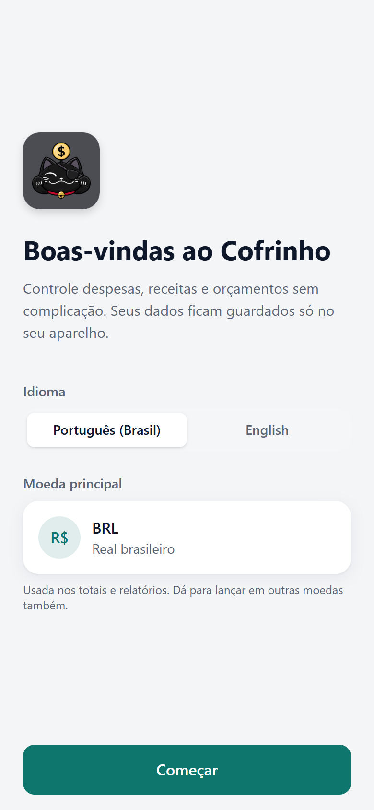<br><sub>Boas-vindas</sub></td>
    <td align="center" width="33%"><br><sub>Início</sub></td>
    <td align="center" width="33%">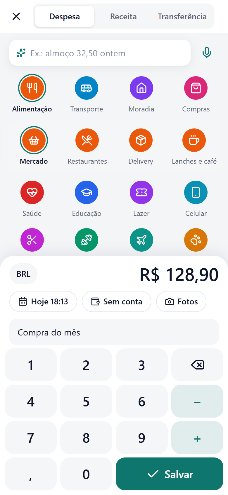<br><sub>Novo lançamento</sub></td>
  </tr>
  <tr>
    <td align="center">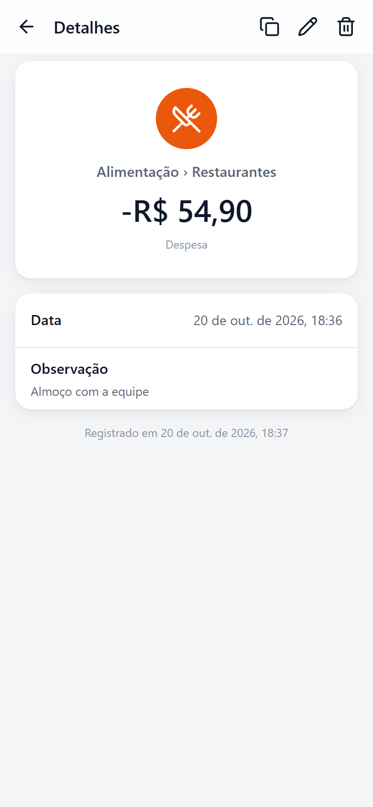<br><sub>Detalhes do lançamento</sub></td>
    <td align="center">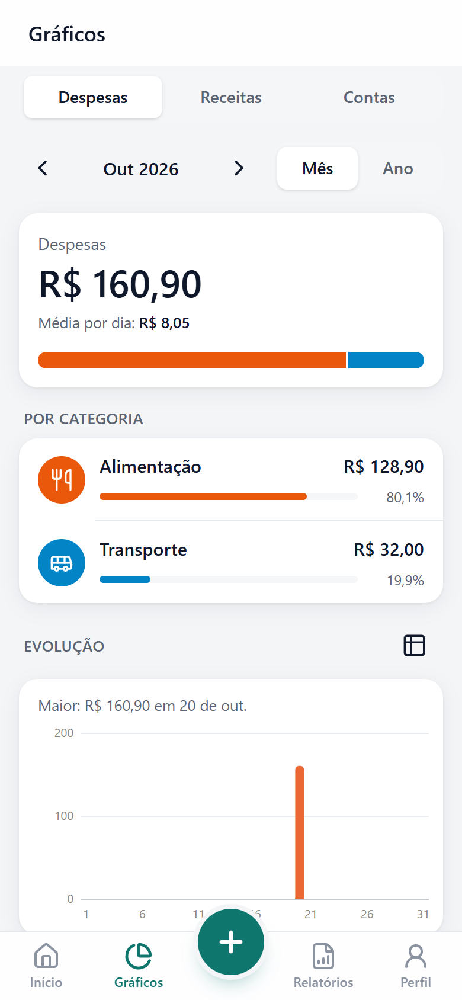<br><sub>Gráficos</sub></td>
    <td align="center">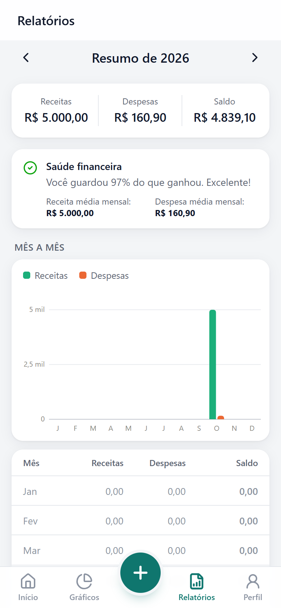<br><sub>Relatórios</sub></td>
  </tr>
  <tr>
    <td align="center">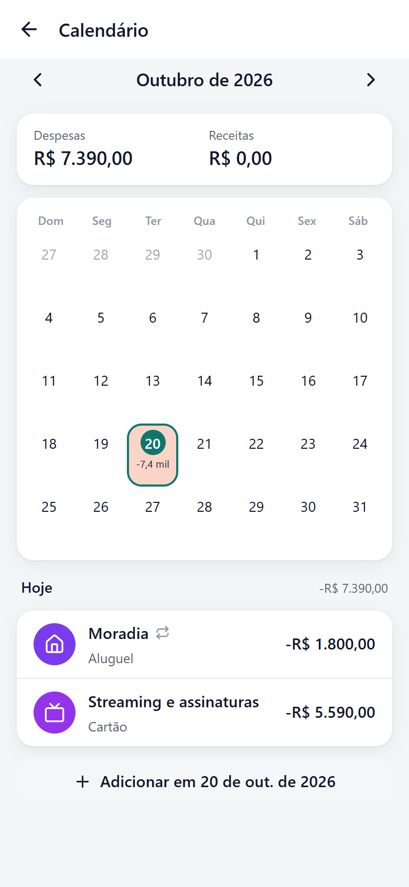<br><sub>Calendário</sub></td>
    <td align="center">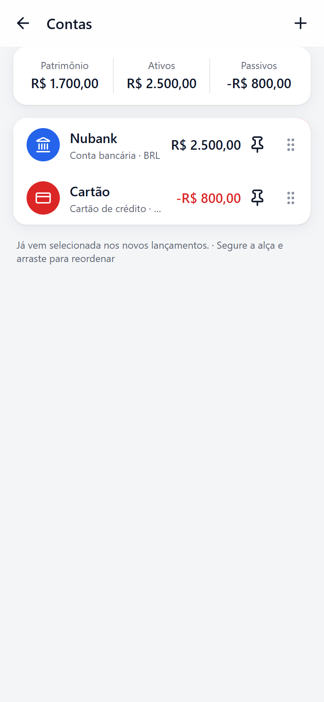<br><sub>Contas</sub></td>
    <td align="center">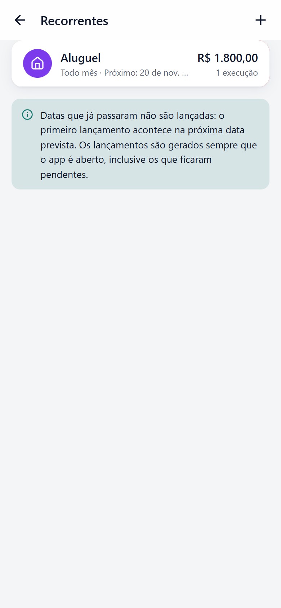<br><sub>Recorrentes</sub></td>
  </tr>
  <tr>
    <td align="center">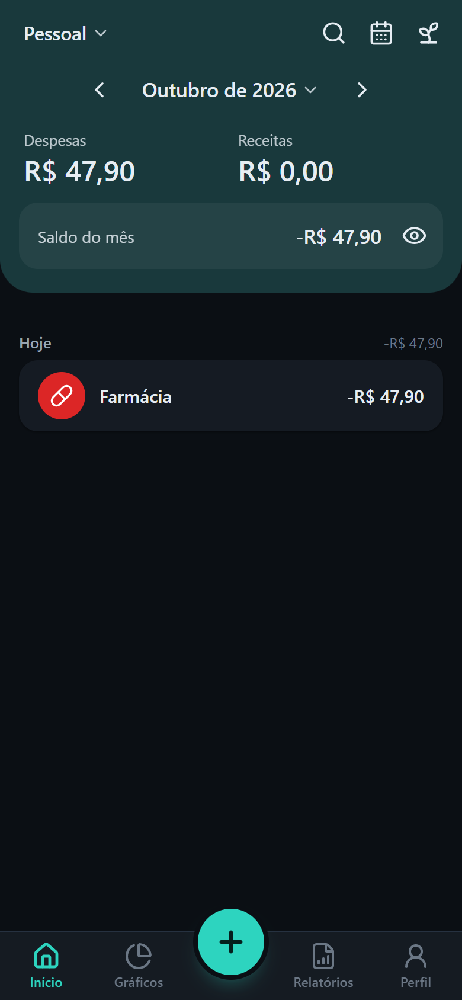<br><sub>Modo escuro</sub></td>
    <td align="center">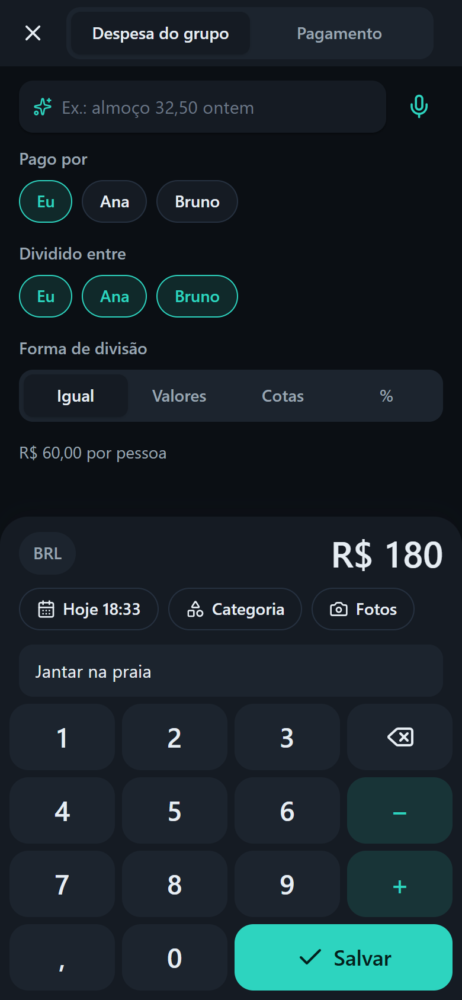<br><sub>Despesa do grupo</sub></td>
    <td align="center"><br><sub>Acerto de contas</sub></td>
  </tr>
  <tr>
    <td align="center">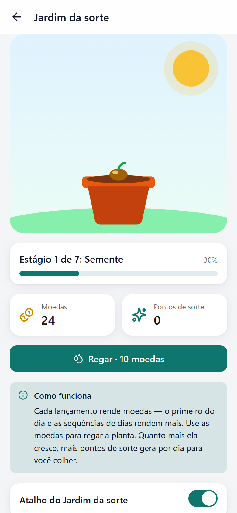<br><sub>Jardim da sorte</sub></td>
    <td align="center">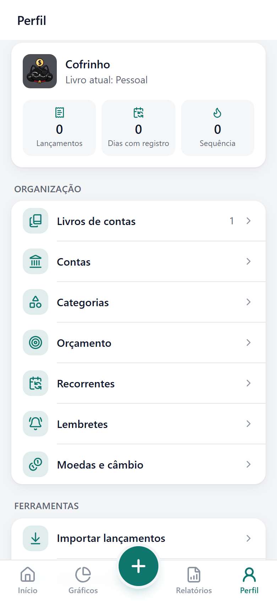<br><sub>Perfil</sub></td>
    <td align="center">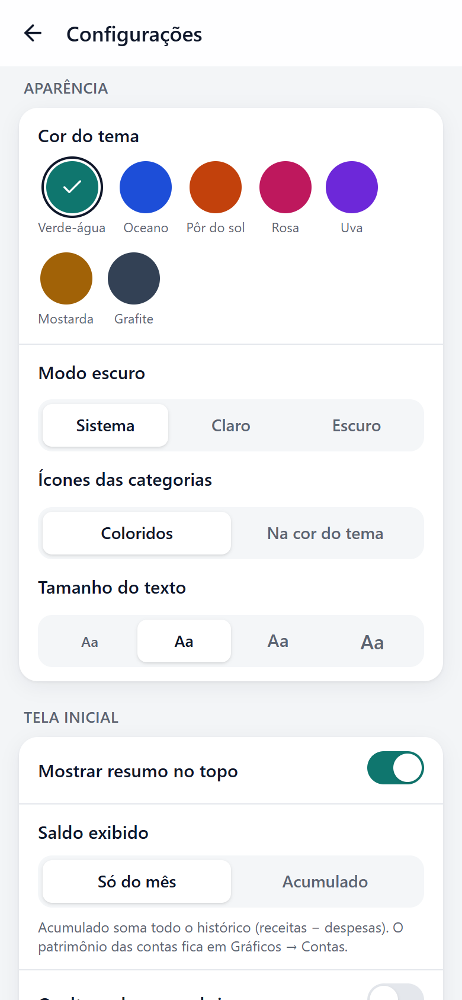<br><sub>Configurações</sub></td>
  </tr>
</table>

## Funcionalidades

### Lançamentos

- Despesa, receita e transferência entre contas.
- Teclado com calculadora (somar/subtrair, e opcionalmente multiplicar/dividir).
- Categorias e subcategorias com ícone e cor; data e hora; conta; fotos da câmera ou galeria.
- Observação com sugestões das mais usadas em cada categoria.
- Moeda estrangeira com conversão automática para a moeda do livro.
- **Lançamento rápido**: escreva ou dite “almoço 32,50 ontem nubank” e o formulário se preenche.

### Acompanhamento

- **Início**: despesas, receitas e saldo do mês (ou acumulado), ocultar valores, troca de mês por setas, seletor ou deslize, lista por dia.
- **Gráficos**: participação por categoria, ranking, evolução diária/mensal com média, comparação com o período anterior e patrimônio por conta.
- **Relatórios**: resumo do ano, taxa de poupança, receitas × despesas mês a mês e maiores categorias.
- **Calendário**: valores e intensidade de gasto por dia e orçamento disponível por dia.
- **Busca** por texto, valor, tipo, categoria, ano e conta, com a soma dos resultados.

### Planejamento

- **Orçamento** mensal e por categoria, com alerta de estouro.
- **Mês financeiro** começando em qualquer dia de 1 a 28 (ex.: de 26 a 25, para acompanhar a fatura).
- **Recorrentes**: aluguel, salário e assinaturas em 9 frequências, com limite de vezes, lançados automaticamente ao abrir o app (inclusive os pendentes).
- **Lembretes** diários ou em dias da semana, por notificação.

### Contas e livros

- Contas: dinheiro, banco, cartão de crédito, carteira digital, investimento, “a receber” e “a pagar”.
- Saldo inicial, conta padrão, ajuste de saldo, “não somar nos totais” e ordenação por arrastar.
- Vários **livros**: pessoal, negócio, projeto e **dividido**.
- No livro dividido: quem pagou, divisão igual, por valores, cotas ou porcentagem, e **acerto inteligente** com o mínimo de pagamentos.

### Dados

- **Importar** extratos CSV, Excel e JSON, com detecção de colunas, datas e possíveis duplicados.
- **Exportar** em Excel, CSV, JSON ou relatório HTML (até 1 ano por arquivo).
- **Backup e restauração** completos em um único arquivo, incluindo as fotos.

### Personalização e segurança

- 7 cores de tema, modo escuro, ícones coloridos ou monocromáticos, tamanho do texto e formato dos números.
- Bloqueio por PIN e biometria (digital/rosto).
- **Jardim da sorte**: cada lançamento rende moedas para regar uma planta que cresce em 7 estágios.

## Instalar no celular

O APK pronto fica em **`release/Cofrinho-1.0.0.apk`** — um arquivo só, para qualquer celular Android 7.0 ou superior.

1. Copie o arquivo para o celular (cabo USB, Google Drive, WhatsApp…).
2. Toque no arquivo e permita **“instalar apps desconhecidos”** para o app usado para abri-lo.
3. Toque em **Instalar**.

> **Importante — chave de assinatura.** O APK é assinado com `android/keystore/cofrinho-release.jks`; a senha fica em `android/keystore.properties`. Os dois estão fora do Git. **Guarde-os**: sem eles, uma versão nova não instala por cima da atual (seria preciso desinstalar, o que apaga os dados). Faça também backups pelo app em *Perfil → Backup e restauração*.

## Como a engenharia reversa foi feita

Ferramenta: **REA v6.7.0**, pela linha de comando (`node scripts/rea.mjs …` na pasta do REA).

| Etapa | Como | Resultado |
|---|---|---|
| Tipo de app | `rea identify-flutter-build` | Flutter; hash do snapshot Dart `78da37fe…3f`; engine `0d216f3f…2a51` |
| Código compilado | `rea inspect-dart-aot` | módulos `package:moneymanager/…` e ~4.000 nomes/chaves |
| Banco de dados | strings do `libapp.so` | os 15 `CREATE TABLE` do SQLite (lançamentos, contas, categorias, orçamentos, recorrentes…) |
| Manual e textos | assets do `base.apk` | 26 artigos de ajuda com as regras de cada função; traduções em 40+ idiomas |
| Dependências | `NOTICES.Z` | 325 pacotes (sqflite, Firebase, anúncios, compras, biometria, widget…) |
| Validação do app novo | `rea capture-browser-scenario` (Playwright + Edge) | roteiros em tela de celular, modos claro e escuro, sem erros de página |

As regras recuperadas — recorrentes que não retroagem e recuperam datas pendentes, orçamento total que acompanha as categorias, limite de 1 ano na exportação, observação com até 60 caracteres, divisão AA — estão detalhadas, com o mapa completo de funcionalidades, em **[docs/analise-engenharia-reversa.md](docs/analise-engenharia-reversa.md)**.

## Original × Cofrinho

| No app original | No Cofrinho |
|---|---|
| Lançamentos, categorias, contas, orçamento, recorrentes, lembretes, calendário, gráficos, relatórios, busca, exportação, temas, bloqueio, jardim da sorte | ✅ recriados |
| Livro AA (despesas divididas) | ✅ com membros locais e acerto inteligente |
| “AI record” (lançar por texto/voz) | ✅ adaptado: interpretação local, sem nuvem |
| Importar extratos | ✅ CSV, Excel e JSON (PDF e foto dependiam de IA na nuvem) |
| Login, backup na nuvem, vários aparelhos | ↔ substituído por backup e restauração em arquivo |
| Livros de equipe e compartilhamento familiar | ❌ exigem o servidor do desenvolvedor |
| Assistente de IA, leitura de recibos, lançamento por notificação | ❌ dependiam do Gemini/servidor do desenvolvedor |
| Anúncios, assinatura premium, API, widget | ❌ fora do escopo (tudo liberado, sem anúncios) |

## Desenvolvimento

Requisitos: **Node.js 22+**. Para gerar o APK: **JDK 21** e **Android SDK** (platform 36) — nesta máquina em `%USERPROFILE%\.jdks\temurin-21` e `%LOCALAPPDATA%\Android\Sdk`.

```bash
npm install
npm run dev         # app no navegador: http://localhost:5173
npm test            # testes (Vitest)
npm run typecheck   # checagem de tipos
npm run build       # build web/PWA em dist/
npm run apk         # build + Capacitor + Gradle → release/Cofrinho-<versão>.apk assinado
npm run icons       # regenera os ícones (PWA e Android) a partir da arte em icon/
npx cap open android  # abre o projeto nativo no Android Studio
```

Tecnologias: React 19, TypeScript 5.9, Vite 7, Tailwind CSS 4, Dexie (IndexedDB), React Router 7 e Capacitor 8 (Android).

## Arquitetura

```text
src/
  domain/    regras puras e testadas: dinheiro, datas e períodos, recorrência, divisão AA,
             orçamento, saldos, estatísticas, calculadora e lançamento rápido
  data/      banco local (IndexedDB): livros, contas, categorias, lançamentos, orçamentos,
             recorrentes, lembretes, câmbio, backup e importação
  io/        CSV, Excel (leitura e escrita próprias), exportadores e importadores
  services/  recursos do aparelho: notificações, arquivos e compartilhamento, bloqueio,
             biometria, sons, vibração, voz e jardim
  i18n/      textos em português (Brasil) e inglês
  ui/        telas, componentes e gráficos em SVG
android/     projeto nativo (ícones, splash, assinatura)
icon/        arte do ícone do app
docs/        relatório da engenharia reversa e capturas de tela
```

Decisões principais:

- **Dinheiro em números inteiros** na menor unidade de cada moeda (centavos etc.), nunca em ponto flutuante.
- **Três valores por lançamento**, como no original: na moeda do livro (estatísticas), na moeda da conta (saldos) e na moeda digitada.
- **Local-first**: todos os dados ficam no aparelho; o backup em arquivo substitui a nuvem.
- **Uma base de código** para Android (via Capacitor) e para a web (PWA instalável).

## Testes e verificação

- **84 testes automatizados** (`npm test`) cobrindo regras de domínio, banco de dados e importação/exportação.
- **Roteiros no navegador** feitos com o REA em tela de celular (390×844), nos modos claro e escuro: boas-vindas, lançamentos, contas, recorrentes, calendário, busca, livro dividido, acerto de contas e jardim — todos sem erros de página. As capturas acima saíram desses roteiros.
- **APK** conferido com as ferramentas oficiais do Android (`apksigner verify` e `aapt2 dump badging`).

## Privacidade

Tudo o que você registra fica guardado apenas no seu aparelho. O app não tem contas, anúncios nem rastreamento. A única conexão externa é a consulta opcional de cotações de câmbio.

## Aviso legal

- Projeto independente, **sem vínculo** com o desenvolvedor do “Money Tracker – Expense Budget”; nomes e marcas citados pertencem aos seus donos.
- A engenharia reversa foi usada para **estudar funcionalidades**. O código do Cofrinho foi escrito do zero e não contém código, imagens, sons nem textos do app original.
- O arquivo do app original analisado **não faz parte do repositório** (está no `.gitignore`).

## Créditos

- **Ícone do app**: arte própria do projeto (`icon/`) — o gato da sorte pirata com a moeda dourada.
- **Ícones da interface**: [Lucide](https://lucide.dev) (licença ISC).
- **Cotações de referência**: [currency-api](https://github.com/fawazahmed0/exchange-api) (dados públicos).
- **Análise**: [REA — Reverse Engineer Anything](https://github.com/morluto/rea).
